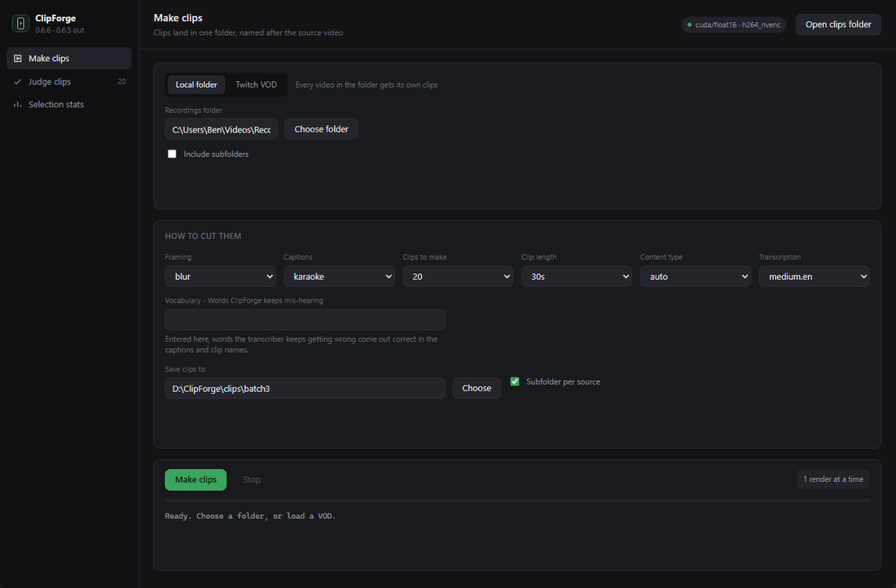
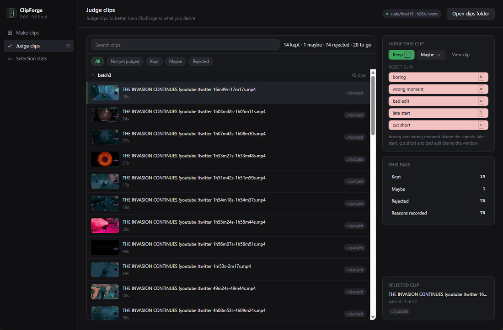
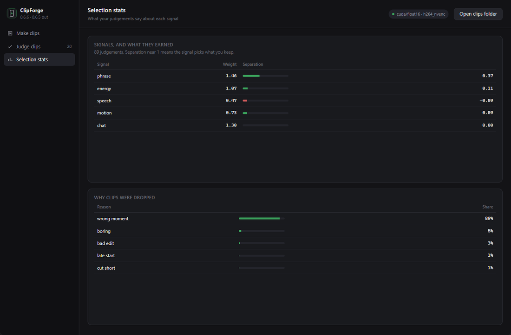

<p align="center">
  
</p>

# ClipForge

Turns a livestream recording, or a Twitch VOD link, into vertical clips you can post: it transcribes once, scores every signal it can find, cuts the best moments into 1080x1920 with burned-in captions, and learns your taste from the clips you keep.

## Install

1. **[Download ClipForge](https://github.com/TheBen420/ClipForge-Automate-Making-Clips-of-Your-Conten-/archive/refs/heads/main.zip)**, then right-click the zip and choose **Extract All**.
2. Double-click **Install ClipForge** in the extracted folder.
3. Wait about three minutes. It fetches Python and ffmpeg if the machine hasn't got them, installs what ClipForge needs, checks this PC can really render video, and puts **ClipForge** on the desktop.
4. Double-click **ClipForge** on the desktop.

Windows may warn that the file came from the internet: **More info → Run anyway**. Everything installed comes from Microsoft's own package manager or python.org.

Your clips land in a `ClipForge` folder on your `D:` drive, or `C:` if there isn't one. The first time you make clips it downloads a 1.5 GB speech model, once; after that it runs offline.

## Make clips



Pick **Local folder** and point it at recordings, or **Twitch VOD** and paste a `twitch.tv/videos/...` link. Then choose framing, captions, how many clips and how long, and press **Make clips**. The log underneath says what it is doing; **Stop** halts between steps.

For a VOD only the moments worth clipping get downloaded, so a five-hour stream doesn't cost five hours of bandwidth. Twitch chat can be pulled as an extra signal for spotting the good bits, and **Vocabulary** takes the names the transcriber keeps getting wrong so the captions spell them right.

Every run puts its clips in a subfolder named after the source, with only the clip and its cover frame inside:

```
D:\ClipForge\clips\Palworld Good Ultra Boss Kills\
    Moon Lord 0m10s-0m23s.mp4        <- clip, named after its source video
    Moon Lord 0m10s-0m23s-thumb.jpg  <- cover frame, same 1080x1920 canvas
```

`Open clips folder` jumps straight there.

## Two clips can render at once, and it is switched off on purpose

Rendering overlaps by design. Each clip decodes on the CPU and encodes on the GPU, so two clips in flight use both halves of the machine, and `render_workers` in `config.json` is what decides how many are in flight. It is set to 1, and that is a measurement rather than an oversight: two at once pushed CPU use from 31% to 92% to save 4% of the wall clock, so the extra heat and fan noise bought nothing. The capability is still there for anyone who wants it — set `render_workers` to 2 and restart — and the cap is 2, because a render already fills every core and a third is how a fan curve turns into a thermal shutdown. A number above 2 is held at 2 with a line in the log saying so. Nothing in the window writes that key, so a hand edit survives every later save of the other settings.

The full story, including the measurements and the other cap values, is in **[docs/reference.md](docs/reference.md)**.

## Judge clips



Judging is how ClipForge learns what you actually want. The tab lists every clip on disk, grouped by the batch it came from, with covers, filters by verdict, and search. Keep it, mark it maybe, or reject it with a reason — *boring*, *wrong moment*, *bad edit*, *bad captions*, *late start*, *cut short* — using `k`, `m`, and `b`/`w`/`e`/`s`/`l`/`c`. The list advances to the next clip on its own.

Click a cover, or double-click a row, to watch the clip in the window while you judge; the keys keep working, and the clip moves on when you do.

## Stats



Every judgement is stored in `D:\ClipForge\feedback.jsonl`, and this tab reads it back: how many clips you have kept, and how strongly each signal separates the clips you kept from the ones you rejected. A signal near zero isn't telling your clips apart, and its weight drifts down as you judge more.

## Updating and removing

The app compares itself against this repository once a day. When there is a newer build, an **Update** button appears in the rail above the version line: press it and ClipForge downloads the new version, installs it over itself, and reopens. Nothing to unzip, no installer to run twice. If an update ever fails, the reason is written to `update.log` in the temporary folder the updater names in the log.

You can still do it by hand — download the zip again and run **Install ClipForge** from the new folder — which copies over the old install and reuses the private Python. Either way your clips, transcripts and judgements are untouched.

**Uninstall ClipForge** removes the app, its private Python and the desktop shortcut. It keeps `D:\ClipForge` unless you type `DELETE CLIPS` at the prompt.

## From a terminal

The installer does this by hand; it is also the only supported route on macOS and Linux.

```
git clone https://github.com/TheBen420/ClipForge-Automate-Making-Clips-of-Your-Conten-.git
cd ClipForge-Automate-Making-Clips-of-Your-Conten-
py -m venv .venv
.venv\Scripts\activate          # macOS and Linux: source .venv/bin/activate
pip install -r requirements.txt
py clipforge.py doctor          # proves ffmpeg, an H.264 encoder, whisper, yt-dlp and the disk
py clipforge_gui.py             # the desktop app
```

ffmpeg has to be on the PATH for this route (`winget install Gyan.FFmpeg`, `brew install ffmpeg`, `apt install ffmpeg`). Python 3.10 or newer. On an NVIDIA machine, uncomment the CUDA wheels in `requirements.txt` to transcribe on the GPU; everything works on the CPU without them, just slower.

The command line does everything the window does, and some things it doesn't:

```
cf new                          # add and transcribe anything new in the watch folders
cf suggest my-stream            # ranked moments, ready to copy-paste
cf make my-stream --from 1:23:45 --dur 45
cf auto my-stream --top 3       # let it pick and render three on its own
cf review                       # judge the last run
cf doctor                       # check the machine
```

`config.json` next to the script holds the paths and tuning; it is created on first run and is deliberately git-ignored. Every command, the scoring maths, the speed measurements and the config keys are in **[docs/reference.md](docs/reference.md)**.

## Licence

MIT. See [LICENSE](LICENSE).
