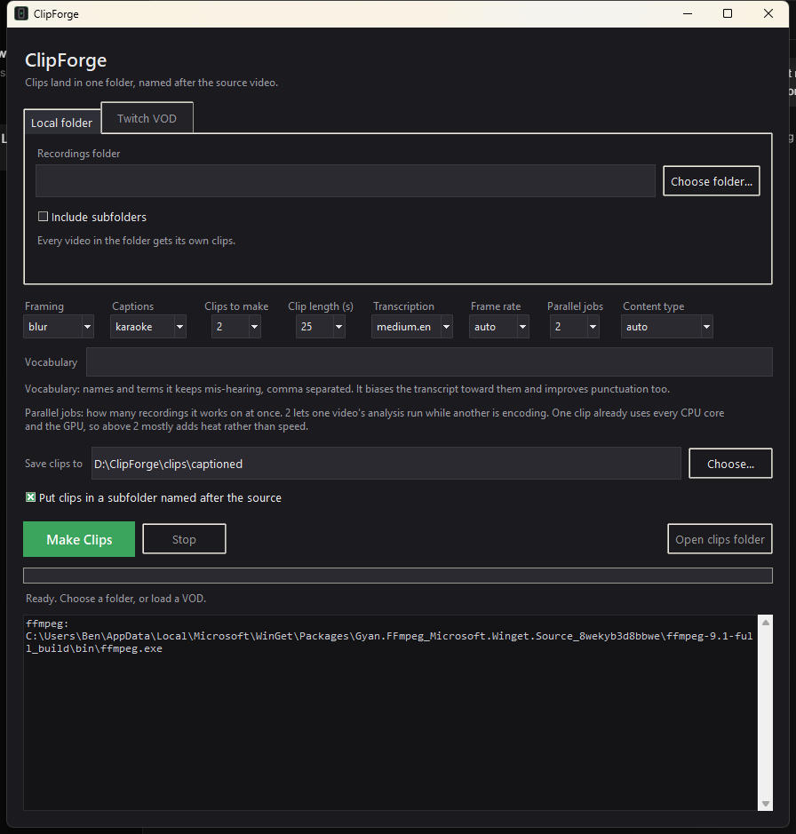
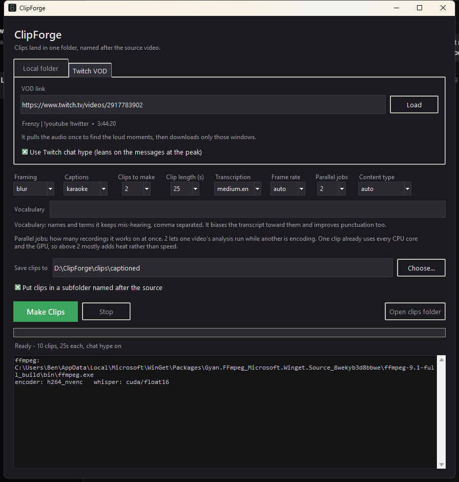
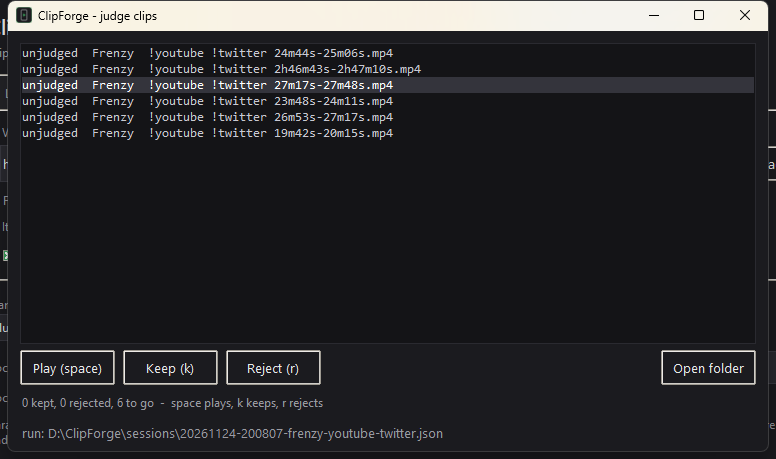

<p align="center">
  
</p>

# ClipForge

Turns a livestream recording (or a VOD link) into vertical, captioned, post-ready clips: it transcribes once, scores every signal it can find, cuts the strongest moments into 1080x1920 with burned-in captions, and learns your taste from the clips you keep.

## Install

### Windows, without touching a command line

1. **[Download ClipForge](https://github.com/TheBen420/ClipForge-Automate-Making-Clips-of-Your-Conten-/archive/refs/heads/main.zip)**, then right-click the zip and choose **Extract All**.
2. Open the extracted folder and double-click **Install ClipForge**.
3. Wait about three minutes. It fetches Python and ffmpeg if the machine doesn't have them, installs what ClipForge needs, checks the PC can actually render video, and puts **ClipForge** on the desktop.
4. Double-click **ClipForge** on the desktop.

Your clips land in a `ClipForge` folder on your `D:` drive, or `C:` if there isn't one. The first time you make clips it downloads the 1.5 GB speech model, once; after that everything runs offline. Windows may warn that the file came from the internet: **More info → Run anyway**. Everything it installs is either from Microsoft's own package manager (winget) or from python.org.

### Updating and removing

The app checks GitHub once a day in the background and shows a **Version x.y.z is out** button in the top right when there is something newer; `cf update` prints the same comparison, with `--fresh` to bypass the half-day cache. To update, download the zip again and run **Install ClipForge** from the new folder: it copies over the old install and reuses the private Python, so it takes seconds. Your clips, transcripts and judgements are untouched.

**Uninstall ClipForge** in the install folder removes the app, its private Python and the desktop shortcut. It keeps `D:\ClipForge` by default — your clips and transcripts are only deleted if you type `DELETE CLIPS` at the prompt.

### Any machine, from a terminal

This is what that installer does by hand, and the only supported path on macOS and Linux.

```
git clone https://github.com/TheBen420/ClipForge-Automate-Making-Clips-of-Your-Conten-.git
cd ClipForge-Automate-Making-Clips-of-Your-Conten-
py -m venv .venv
.venv\Scripts\activate          # macOS and Linux: source .venv/bin/activate
pip install -r requirements.txt
py clipforge.py doctor           # proves ffmpeg, an H.264 encoder, whisper, yt-dlp and the disk
py clipforge_gui.py              # the desktop app
```

ffmpeg has to be on the PATH for this route (`winget install Gyan.FFmpeg` on Windows, `brew install ffmpeg` on macOS, `apt install ffmpeg` on Linux). Python 3.10 or newer. Nothing else is assumed about the machine - no NVIDIA card, no specific encoder, no font.

The first run writes `config.json` next to the script with sensible defaults and creates `D:\ClipForge` for the library, clips and session logs (change `media_root` in that file to move it). `config.json` is deliberately git-ignored: it holds machine paths and your own tuning, and the defaults live in `DEFAULT_CONFIG` inside `clipforge.py`. Optional: `cf.cmd` is a one-line shim for putting `cf` on the PATH; the desktop shortcut is `pythonw clipforge_gui.py`.

On an NVIDIA machine, uncomment the CUDA wheels in `requirements.txt` to transcribe on the GPU. Everything works on the CPU without them, just slower.

## Desktop app



Double-click **ClipForge** on the desktop (or in the Start Menu). It has two tabs, and the options either side of them are shared:

**Local folder** — point it at a folder of recordings. **Twitch VOD** — paste a `twitch.tv/videos/...` link, press Load to confirm the title and length, then Make Clips.



For a VOD it downloads the audio once to find the loud moments, then pulls only those windows of video, so a four-hour stream doesn't need four hours of bandwidth.

Pick framing, captions, how many clips and how long, then hit **Make Clips**. Either source gets transcribed once, the strongest moments found, and the clips rendered.

Every run gathers its clips into a subfolder named after the source folder, inside whatever destination you pick. Only the clip and its thumbnail go in there, so it's drop-in ready:

```
D:\ClipForge\clips\Palworld Good Ultra Boss Kills\
    Moon Lord 0m10s-0m23s.mp4        <- clip, named after its source video
    Moon Lord 0m10s-0m23s-thumb.jpg  <- cover frame, same 1080x1920 canvas
    Xeno 0m07s-0m20s.mp4
    Xeno 0m07s-0m20s-thumb.jpg
```

The subfolder is reused when you run the same source folder again, and a clip that would collide gets ` (2)` rather than overwriting. Untick **Put clips in a folder named after the source folder** to drop the clips straight into the destination instead.

The **Open clips folder** button jumps straight there. The command line still writes one folder per clip under `D:\ClipForge\ready\`, and there it also drops the `.srt` sidecar and the `.txt` notes with the hook and transcript.

Files modified in the last minute are skipped, so a recording that is still being saved won't be indexed half-finished. **Stop** halts between steps, not mid-render.

To preload a folder, launch it with `pythonw clipforge_gui.py "D:\some\folder"`.

## Command line

Plain `cf` commands from any terminal. Everything renders to `D:\ClipForge\ready\<stream>\<start>-<end>\`.

## The loop

```
cf new                                    # grab freshly finished recordings and transcribe them
cf suggest my-stream                     # ranked moments, ready to copy-paste
cf find my-stream "when I called the boss ugly"
cf make my-stream --from 1:23:45 --dur 45 --snap --caps
cf auto my-stream --top 3                # or let it pick and render three on its own
```

## Commands

| command | what it does |
| --- | --- |
| `cf add <file-or-url> [--name x]` | register a recording (local file, Twitch/YouTube VOD link) |
| `cf index <name>` | transcribe with word timings (cached; ~40x realtime on the 4080) |
| `cf ls` | what's in the library, and whether it's transcribed |
| `cf find <name> "words"` | search the transcript, prints timestamps and a ready `make` line |
| `cf suggest <name>` | ranks moments by audio energy + speech density, prints `make` lines |
| | if the audio track is too quiet to rank, it ranks by on-screen motion instead |
| `cf make <name> --from 1:23:45 --dur 45` | render one clip |
| `cf auto <name> --top 3` | render the three best auto-detected moments, no timestamps needed |
| `cf batch <name> clips.csv` | render many from a csv of `start,end` (or `start,duration`) rows |
| `cf new` | scan the watch folders, add + transcribe anything new |
| `cf review [session-or-folder]` | judge clips from a run that already finished |
| `cf doctor` | verify ffmpeg, NVENC, whisper, yt-dlp, disk |

`--from`/`--to`/`--dur` accept `5025`, `83:45`, `1:23:45`, or `1h2m3s`.

## What `make` produces

Per clip, named after the source footage it came from plus the window it covers — `Moon Lord 2m31s-2m57s.mp4`:

- `.mp4` - 1080x1920, H.264 (NVENC), 60fps when the source is 60fps, AAC 192k loudness-normalised to -14 LUFS, `+faststart` so it uploads instantly
- `-thumb.jpg` - 1080x1920 cover frame
- `.srt` - sidecar subtitles, if you'd rather upload those than burn them in
- `.txt` - the hook line, the full in-clip transcript, and hashtags, so posting is copy-paste

Framing defaults to `blur`: the full 1920x1080 frame shrunk to fit with a blurred fill above and below, captions underneath, nothing cropped away. `--fit crop` instead punches a 9:16 window out of the frame (`--focus 0..1` slides it left/right), which fills the screen but throws away 68% of the width. `--fit black` is the same as blur with a near-black backdrop.

Captions default to `karaoke`: three or four words on screen, the word being spoken highlighted, burning in via libass. `--captions block` shows whole phrases instead, `--captions off` for none. `--caps` for ALL CAPS.

## How moments get picked

Five signals are scored over sliding windows, each normalised against its own spread so they can be added:

| signal | what it notices |
| --- | --- |
| `energy` | loudness swings: shouting, hits, music stings |
| `speech` | words per second, for commentary-heavy footage |
| `motion` | on-screen motion and brightness change, for silent gameplay |
| `chat` | Twitch chat message rate, with hype words and ALL-CAPS counted double |
| `phrase` | your `boost_phrases` list matched against the transcript |

Weights live in `config.json` under `weights`. Three presets ship with it — `boss kill`, `commentary`, `reaction` — which also set framing, captions and clip length. Pick one in the **Content type** box, or leave it on `auto` and use the global weights. Windows start no more than three seconds before the spoken sentence containing the peak and end on the nearest spoken word boundary within `max(1.4 x length, length + 4s)`, so a 25-second request lands between about 20 and 33 seconds instead of running on until a long sentence finishes. The first and last tenth of a recording (capped at a minute) is skipped so intros and outros don't win.

For a Twitch VOD, tick **Use Twitch chat hype** and it pulls the chat replay first — chat spikes are the most reliable "something happened" signal on a quiet stream. `cf chat <name> --file chat.json` imports a chat log you already have.

The replay is read a hundred messages at a time, each request asking Twitch for the next hundred after a timestamp. Their cursor API now fails an integrity check for anonymous clients, so the offset form is the one that works; a busy three-hour VOD is about 11,000 messages in well under a minute. Twitch only hands back what it kept, though: a VOD whose chat never got going has a handful of messages, so anything under five is refused with the count and the run ranks on the other signals instead.

## Judging clips, and what the numbers mean



After a run the app shows the clips it made with **Keep** and **Reject**. Every judgement goes into `D:\ClipForge\feedback.jsonl` alongside the scores that produced that clip. `cf stats` reads it back:

```
Feedback: 24 clip(s) judged - 15 kept (63%)
  rank 1: kept 9/12 (75%)
  rank 2: kept 4/12 (33%)

Signal separation (mean score of kept vs rejected clips):
  signal       kept  rejected  separation
  chat         1.84      0.71        0.44
  motion       0.92      0.88        0.02
```

A separation near 0 means that signal isn't telling your kept and rejected clips apart, and its weight will drift down as you judge more; near 1 it is earning every bit of its weight. Each run also writes `D:\ClipForge\sessions\<timestamp>-<recording>.json` with every candidate's features, the per-signal spread across the recording, and what was rendered — that's the raw data behind the numbers above.

Judging doesn't need the app that made the clips. **Judge last run** on the review tab opens the newest session in its own window, and `cf review` does the same from a terminal: `cf review` takes the latest run, `cf review <session.json>` or `cf review <folder>` takes a specific one. It follows clips that have since been moved, since it matches on filename. Space plays the selected clip, `k` keeps it, `r` rejects it, and the list moves on to the next unjudged clip by itself.

Ask for more clips than the recording can support without overlap and you'll get fewer than you asked for; a 90-second file with one standout moment yields one clip.

### How the weighting learns

`weights` in `config.json` is the baseline: energy 1.0, speech 0.5, motion 0.7, chat 1.3, phrase 1.2. Those numbers are a starting opinion, not a tuning - they came from watching what separates a good moment from a boring one across the footage this was built on.

Every judgement you make moves them. Each signal is compared on the clips you kept against the clips you rejected, on a signed scale where 1 means only kept clips scored on it and 0 means the two are indistinguishable:

```
  signal       kept  rejected  separation
  phrase       0.09      0.00        1.00
  energy       1.52      1.49        0.01
  speech       0.35      0.43       -0.10
```

The multiplier applied to that signal's baseline weight is `1 + 0.6 x separation`, clamped to 0.5-1.5, and only once a signal has at least 3 kept and 3 rejected clips behind it. A flat signal is left alone; a signal that scores just as high on clips you reject is pulled down; one that only fires on clips you keep is pushed up. So the effective weight of `phrase` above is 1.2 x 1.5 = 1.8 while `energy` stays at 1.0.

Two properties matter here. The multipliers are derived from `feedback.jsonl` on every run rather than saved into `config.json`, so the config stays the readable baseline and the feedback stays the state - delete judgements and the weighting returns to baseline. And the effective weights are written into each session file next to the candidates they ranked, so any past run can be re-read knowing exactly what weighting produced it. `cf stats` prints the table above plus the baseline, learned and effective weight for every signal.

## Speed

Measured on a 1440p60 source, two recordings, four clips total:

| setup | wall time |
| --- | --- |
| one job, 60fps | 32.3s |
| one job, 60fps, current filter chain | 29.7s |
| two jobs, 60fps | 29.0s |
| two jobs, 30fps | 21.6s |

Where the time goes for a 24-second clip: about 9s in ffmpeg, 0.1s on the audio RMS, 4.7s to analyse a whole 100s recording. The render dominates, and it is CPU-bound on decode and filtering while NVENC handles the encode — which is why running jobs in parallel only gains ~10%: one render already uses every core. Decoding on the GPU instead (NVDEC) measured *slower* once the filter chain was cheapened, so decoding stays on the CPU.

What actually helps:

- **Parallel jobs** overlaps one job's analysis with another's render. Capped at 2 by choice: one render already uses every core, so a third job mostly raises the temperature.
- **Frame rate 30** roughly halves the per-frame cost — 29.0s down to 21.6s for the same four clips. Set it in the Frame rate box; leave it on `auto` to match the source.
- **The filter chain** blurs the background at quarter resolution and scales with bicubic instead of lanczos. Visually identical, about a third faster per render.

## Config

`config.json` next to this file. The useful knobs:

```json
{
  "media_root": "D:/ClipForge",
  "watch_dirs": ["D:/Vod Temp", "C:/Users/Ben/Videos/Recordings", "D:/Downloaded"],
  "model": "small.en",
  "fit": "blur",
  "captions": "karaoke",
  "font": "Arial Black",
  "font_size": 88,
  "caption_margin_bottom": 330,
  "hashtags": ["#gaming", "#twitch", "#clips", "#streamer", "#twitchclips"],
  "ytdlp_cookies_from_browser": ""
}
```

`model` is the whisper model: `small.en` is the default, `large-v3` gives the best transcript on the 4080. Raise `caption_margin_bottom` to lift captions higher up the frame, lower it to drop them toward the bottom edge. `ytdlp_cookies_from_browser` takes `chrome` or `firefox` for login-walled VODs.

## Captions: accuracy and timing

Two things were wrong early on, and both are fixed.

**Timing.** Caption events were being written at their absolute position in the recording rather than their position in the clip, so a clip taken from 10:36 had its captions scheduled ten minutes into a thirty-second video — in practice, no captions at all unless the clip started near zero. They are now shifted by the clip's own start offset. Word-level karaoke also used to fade in on every word, which blanked the phrase for a frame at each transition; the fade now happens once per phrase. Measured against the expected caption events, burn-in timing agrees on 159 of 160 sampled frames.

**Accuracy.** The default model was `small.en`, which misheard game vocabulary ("chess piece" for "chest piece"). `medium.en` is now the default, with `large-v3` available in the **Transcription** box for the best pass at the cost of speed.

The bigger accuracy lever is the **Vocabulary** field. Whisper can't know your game's proper nouns, so it guesses. List the names it keeps getting wrong, comma separated, and they are fed to the decoder as a prompt:

```
Preludes 13, armor attunement, Steel Singer Stitchy Wicks, Palworld, courage
```

On the same audio this turned "chess piece … the steel singer stitchy wicks" into "chest piece … the Steel Singer Stitchy Wicks", and it restored punctuation and capitalisation as a side effect.

Changing the model re-transcribes automatically the next time a recording is used in the app, since a cache from a weaker model is worse than a fresh pass.

## Running on other hardware

Nothing here assumes an RTX card. At first use clipforge tests which H.264 encoder actually works on the machine and remembers it for the session, in this order: NVENC (NVIDIA), QSV (Intel), AMF (AMD), VideoToolbox (Apple), then libx264 on the CPU. Each candidate is proven with a two-frame test encode, because an encoder can be listed by ffmpeg and still fail without the hardware behind it. If a chosen encoder fails mid-render it falls back to libx264 and says so. `cf doctor` prints what it picked and what else was usable.

Transcription walks down a chain as well: CUDA float16, CUDA int8, CPU int8, CPU int8-float32, CPU float32. A machine with no CUDA lands on CPU int8, and a CPU too old for int8 lands on float32. Set `CLIPFORGE_DEVICE=cpu` to force the CPU path.

Captions ask for `Arial Black` but check what's installed (fontconfig, or Tk's font list) and pick the boldest available substitute — Impact, Segoe UI Black, Arial, Liberation Sans, DejaVu Sans. `cf doctor` shows the font it settled on.

Paths and shell behaviour adapt too: the default media root is `D:\ClipForge` only if that drive exists *and* is writable, otherwise `C:\ClipForge`, otherwise `~/ClipForge`. Opening the output folder uses explorer, `open` or `xdg-open` depending on the OS, and child processes avoid console windows only where that flag exists.

Still Windows-shaped: the desktop shortcut script (`.lnk` files via PowerShell) and `cf.cmd`. On macOS or Linux the app runs with `python3 clipforge_gui.py`; nothing else needs changing.

## Notes

- Twitch VODs: paste the `twitch.tv/videos/...` URL. Only the requested section downloads, so a 4-hour VOD costs you seconds of bandwidth.
- Local files are referenced, never copied or moved. Delete the original and the library entry complains rather than guessing.
- Transcripts are cached in `library/<name>/transcript.json`. Deleting it forces a re-transcribe with a different `--model`.
- Recordings with a very quiet audio track still work: highlighting falls back to on-screen motion, and the audio is lifted to -14 LUFS on the way out. Audio below -45 dB peak is treated as noise floor and dropped rather than amplified.
- Rendered folder names get a `-crop`/`-nocap` suffix when you pass a `--fit` or `--captions` value that differs from the config, so variants of the same moment don't overwrite each other.
- `cf new` and the desktop app skip files modified in the last minute and anything under 20MB (`cf new` only), so a recording mid-save isn't grabbed.
